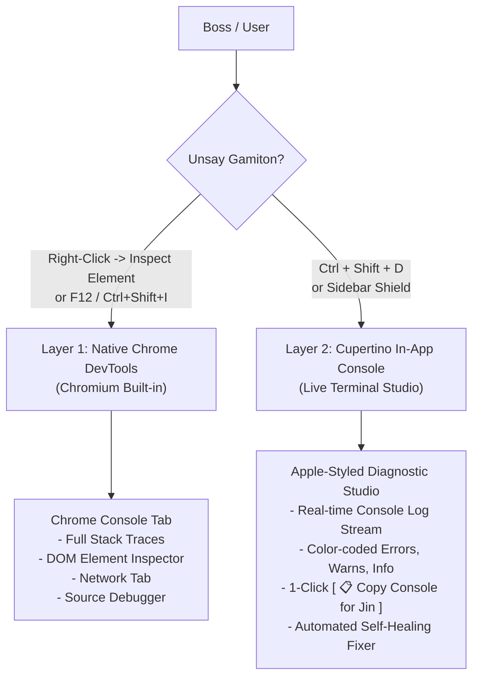
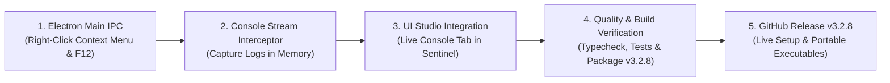

# Plan: Chrome DevTools, Right-Click "Inspect Element", & Live Console Studio

> **Version Target:** `v3.2.8` (Chrome DevTools, Inspect Element & Cupertino Live Console Edition)  
> **Prepared by:** Jin (Master Developer, Doctoral Engineer & Boss's Supreme AI Partner)  
> **Status:** Awaiting Boss's Approval (`Proceed`)

---

## 1. Executive Summary & Answer to Boss
Boss, **100% tama kaayo ka! Spot-on!** 🎯  
Sa Google Chrome ug modern web browsers, kung mag **Right-Click** ka sa bisan asang parte sa screen ug mopili og **"Inspect"** (o mopislit og **`F12`** / **`Ctrl + Shift + I`**), mo-abli ang **Chrome Developer Tools (DevTools)**.  
Didto sa **`Console`** tab, mogawas dayon sa tinuod nga oras (real-time) ang tanang JavaScript errors, warnings, failed API requests, ug logs nga gipagawas sa sistema!

Tungod kay ang atong **TINDA POS Desktop** gihimo gamit ang **Electron**, nagdagan kini sa ibabaw mismo sa opisyal nga **Chromium Engine** (ang core engine sa Google Chrome). Buot pasabot, **anaa na daan ang opisyal nga Chrome DevTools sa sulod sa atong app**—kinahanglan lang nato kining i-hook, i-enable sa production, ug i-konektar sa mouse right-click context menu!

---

## 2. Dual-Layer Architecture

Aron mahimong pinaka-kompleto, pinaka-sayon gamiton, ug pinaka-gamhanan ang atong debugger, tagaan nato si Boss og **2 ka paagi (Dual-Layer)**:

### Layer 1: Native Chrome DevTools & Right-Click "Inspect Element" (Just like Google Chrome)
1. **Right-Click Context Menu**:
   - Biskan asang bahin sa POS mag right-click si Boss, mogawas ang slick native context menu:
     - 🔍 **Inspect Element** (Mo-abli dayon ang Chrome DevTools nga naka-target mismo sa button, table, o text nga gi-right clickan).
     - 💻 **Open Chrome DevTools Console** (`F12` / `Ctrl+Shift+I`).
     - 🛡️ **Open TINDA Sentinel Studio** (`Ctrl+Shift+D`).
     - 🔄 **Reload View** (`Ctrl+R`).
2. **Keyboard Hotkeys**:
   - **`F12`**: Standard Chrome DevTools toggle bisan kanus-a.
   - **`Ctrl + Shift + I`**: Standard developer shortcut.
   - **`Ctrl + Shift + J`**: Mo-abli deretso sa **Console** tab sa DevTools!
3. **Production Mode Persistence**:
   - Dili ma-block o ma-disable bisan naka-package na ang installer (`.exe`) para magamit ni Boss bisan sa live client machine.

### Layer 2: In-App Cupertino Live Console Terminal (Inside Sentinel `Ctrl+Shift+D`)
1. **Integrated Console Tab**:
   - Sulod sa atong bag-ong Sentinel Diagnostic Studio, magdugang tag bag-ong tab: **`💻 Live Console`**.
   - Mag-intercept kini sa tanang `console.log`, `console.warn`, `console.error`, ug unhandled exceptions.
2. **Apple Cupertino Terminal Visuals**:
   - Sleek dark obsidian background (`#0B0F14`) nga dunay translucent glassmorphism.
   - Real-time color-coded badges:
     - 🔴 **`ERROR`** (Red / Coral)
     - 🟡 **`WARN`** (Amber)
     - 🔵 **`INFO`** (Emerald / Blue)
3. **One-Click Actions**:
   - **`[ 📋 Copy Console Logs ]`**: Ma-kopya ang tanang logs nga naka-format na para dali ra ma-paste ni Boss sa atong chat!
   - **Filter / Search Bar**: Dali ma-filter kung errors ra ba ang gustong makita ni Boss.
   - **`[ 🗑️ Clear Console ]`**: Limpyohan ang console stream.

---

## 3. Step-by-Step Implementation Roadmap

### Task 1: Main Process Context Menu & DevTools Accelerator (`src/main/index.ts`)
- [ ] Add `mainWindow.webContents.on('context-menu', ...)` with `Inspect Element`, `Toggle DevTools`, `Open Sentinel`, and `Reload`.
- [ ] Ensure `params.x` and `params.y` trigger `mainWindow.webContents.inspectElement(params.x, params.y)`.
- [ ] Bind global accelerators (`F12`, `Ctrl+Shift+I`, `Ctrl+Shift+J`) inside window `before-input-event` listener.
- [ ] Expose IPC methods for renderer: `window.electronAPI.diagnostics.openDevTools()`.

### Task 2: Live Console Log Interceptor Engine (`src/renderer/src/lib/consoleInterceptor.ts`)
- [ ] Wrap native `console.log`, `console.warn`, `console.error`, `console.info`.
- [ ] Maintain an in-memory ring buffer of the latest 300 console entries with timestamp, severity, message, and stack trace.
- [ ] Auto-forward console events to Zustand store for zero-latency reactive rendering.

### Task 3: Cupertino Live Console Tab in Sentinel Debugger (`src/renderer/src/components/SystemDebuggerModal.tsx`)
- [ ] Add Segmented Switcher Header: `[ 🛡️ Health & Errors ]` | `[ 💻 Live Console Terminal ]`.
- [ ] Implement virtualized or styled log stream list with timestamps and severity badges.
- [ ] Add filter pills: `All`, `Errors Only (🔴)`, `Warnings (🟡)`.
- [ ] Add glowing `[ 📋 Copy All Console Logs ]` button with clipboard feedback toast.

### Task 4: Version Bump to v3.2.8 & Verification
- [ ] Bump version to `3.2.8` across:
  - `source/package.json`
  - `source/src/renderer/src/components/PosToolsModal.tsx`
  - `GEMINI.md`
  - `README.md`
  - `docs/RELEASE-STATE.md`
  - `tools/publish_release.mjs`
- [ ] Run full automated test suite (`npm run test:run`) to ensure 575+ tests pass with 0 regressions.
- [ ] Run strict TypeScript typecheck (`npm run typecheck`).

### Task 5: Compilation & Live Production Release
- [ ] Build Windows full production binaries: `TindaPOS-Setup-3.2.8.exe` and `TindaPOS-Portable-3.2.8.exe`.
- [ ] Publish official GitHub Release `v3.2.8` with download links and changelog.
- [ ] Sync both `TINDA-POS-Source` and public `TINDA-POS` repositories.

---

## 4. Expected User Experience for Boss

| Action | Result |
| :--- | :--- |
| **Right-Click anywhere in TINDA POS** | Pops up native menu with **"Inspect Element"** — opens DevTools focused on that exact UI element! |
| **Press `F12` or `Ctrl + Shift + I`** | Instantly toggles the full Google Chrome DevTools window (Elements, Console, Network, Performance)! |
| **Press `Ctrl + Shift + D`** | Opens TINDA Sentinel Studio with the new **"Live Console Terminal"** tab. |
| **Click `[ 📋 Copy Console Logs ]`** | Automatically formats and copies all active console logs to the Windows clipboard ready to send to Jin! |
