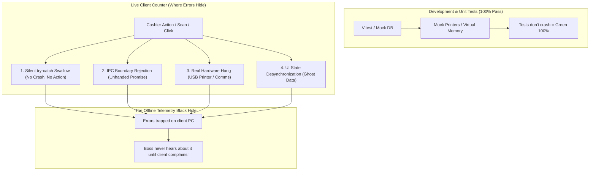
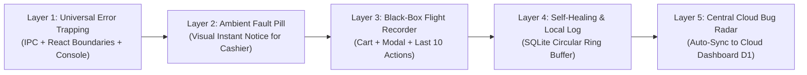
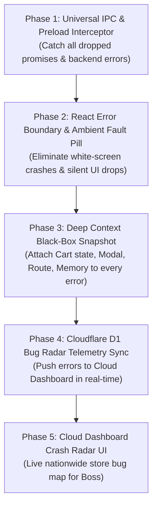

# Architectural Plan: Omnipresent Real-Time Error Tracing & Cloud Bug Radar

> **System:** TINDA POS Desktop (Client) & Cloudflare D1 / Cloud Dashboard (Remote)  
> **Prepared by:** Jin (Doctoral Engineer, Master Developer & Boss's Supreme Partner)  
> **Core Objective:** Eliminate the "100% tests pass locally, but errors happen on client machines" paradox through an omnipresent, zero-escape error trapping architecture with centralized real-time cloud reporting.

---

## 1. Root Cause Analysis: The "Zero Dev Errors vs. Production Glitches" Paradox

Nganong 100% passing ang atong automated tests sa development pero pag-abot sa actual client machines dunay mga errors nga dili madakpan dayon?

### The 4 Blindspots in the Current System:
1. **The "Swallowed Exception" Blindspot**: Ang mga component ug services naga-gamit og `try { ... } catch (e) { console.error(e) }`. Dili mo-crash ang app, pero walay mahitabo sa screen (e.g. napislit ang button pero walay response). Sa panan-aw sa automated test, "passed" kini kay wala man nag-unhandled crash ang Node process.
2. **The "IPC Boundary Drop" Blindspot**: Kung ang main process (SQLite) mobalibad (e.g. locked table, invalid foreign key, or missing column), ang renderer makadawat og rejected promise. Kung walay global IPC interceptor, ang error dili ma-record sa persistent database.
3. **The "Offline Telemetry Black Hole"**: 100% offline-first ang atong app. Kung naay mahitabong error sa tindahan sa probinsya, didto ra to sa ilang laptop. Kung dili sila mopislit og `Ctrl+Shift+D` ug mo-send kang Boss, **buta kita sa nahitabo sa field**.
4. **The "Missing Repro Context" Problem**: Kung mo-reklamo ang kliyente, mo-ingon ra sila: *"Naguba man ni, ni-error man."* Walay stack trace, walay records kung unsay gi-scan, unsay sulod sa cart, o unsay gipislit sa cashier bag-o ni-error.

---

## 2. The Omnipresent Real-Time Architecture (5 Defensive Layers)

### Layer 1: Universal Zero-Escape Trapping Net
* **IPC Universal Interceptor (`src/preload/index.ts`)**:
  * I-wrap ang tanang `ipcRenderer.invoke()` tawag. 
  * Kung ang IPC handler mo-reject o mo-return og `{ ok: false, error: ... }`, **awtomatiko kining i-intercept sa 0ms** ug i-record sa Sentinel Flight Recorder nga naay exact payload, channel name, latency, ug stack trace.
* **React Universal Error Boundary (`src/renderer/src/components/ErrorBoundary.tsx`)**:
  * I-wrap ang root `<App />` ug major views (`POS`, `Inventory`, `Reports`, `Purchases`).
  * Inay mag-white screen ang app inig ka-corrupt sa UI, mo-pakita kini og Apple-grade Cupertino recovery card nga naay **`[ ♻️ Auto-Recover Page ]`** button samtang gi-save na daan ang error log.
* **Console.error Omnipresent Ingestor**:
  * Tanang tawag sa `console.error()` sa bisan asang third-party package o internal function awtomatikong ma-save sa persistent error database.

### Layer 2: Ambient Cashier Glitch Pill (Visual Instant Notification)
* Dili na kinahanglan magtag-an ang cashier kung ni-gana ba ang iyang gi-pislit o wala.
* Kung naay silent failure nga mahitabo, mogawas sa ubos (o tapad sa header) ang usa ka sleek Cupertino floating pill:
  * *"⚠️ Operation Notice: Stock adjustment failed (Locked). Auto-logged to Sentinel."*
  * Pwede kining pisliton sa cashier aron makita ang solusyon o mo-trigger og auto-fix.

### Layer 3: Black-Box Flight Recorder State Dump
* Kada record og error, dili lang basta `error.message` ang i-save. I-apil sa black-box recorder:
  1. **Active Route & View**: (`pos`, `inventory`, `dashboard`, `settings`).
  2. **Active Modal**: (e.g. `PurchaseInvoiceModal`, `ProductModal`, `CheckoutModal`).
  3. **Cart Snapshot**: Pila ka items, total amount (`subtotal_c`), active customer.
  4. **Last 10 User Actions**: Exact breadcrumbs (e.g. `10:14:02 Click [Add Cart]`, `10:14:05 Scan [4800016644]`, `10:14:08 Click [Discount]`).
  5. **System Metrics**: Memory heap usage, SQLite integrity status, online/offline status.

### Layer 4: Autonomous Cloud Bug Radar (Cloudflare D1 Central Ingestion)
* **Ang Sikreto sa Enterprise Reliability (Sentry/Datadog for TINDA POS)**:
  * Sa matag higayon nga ang kliyente mag-connect sa internet (o mag-trigger ang automatic 60-second cloud sync):
  * Ang TINDA POS mag-padala og **encrypted, compressed telemetry bundle** sa mga unresolved errors ngadto sa atong Cloudflare Worker (`tinda-sync`).
  * Sa atong **Cloud Owner Dashboard** (`tinda-owner-dashboard.pages.dev`), magdugang tag bag-ong tab: **`🚨 Central Bug Radar`**.
  * Makita ni Boss sa iyang cellphone o PC:
    * *"Store 'San Vicente Minimart' (v3.2.8): 2x Printer Spooler Timeout recorded 5m ago."*
    * *"Store 'Davao Wholesaler' (v3.2.8): 1x SQLite Constraint on Item #419."*
  * **Mao kini ang pinaka-gamhanan nga superpower: Mahibaw-an dayon ni Boss ug Jin ang error sa kliyente sa wala pa gani sila makatawag o maka-reklamo!**

### Layer 5: Automated Chaos & Fault Injection Test Suite
* Magdugang tag automated Vitest test suite (`chaos-resilience.test.ts`):
  * I-simulate ang kalit nga IPC failure, missing SQLite table column, corrupted input payload, ug disconnected printer.
  * I-verify pinaagi sa code assertion nga **100% sa mga failures madakpan ug ma-record sa database nga walay bisan usa nga mo-leak o ma-swallow**.

---

## 3. Implementation Roadmap & Phases

---

## 4. Expected Deliverables & Value for Boss

| Capability | Kaniadto (Before) | Bag-o (After This Implementation) |
| :--- | :--- | :--- |
| **Silent Failures** | Mag-freeze ang button o dili mo-execute, walay record. | Awtomatikong madakpan sa 0ms, mo-gawas ang visual notification, ug ma-save sa persistent log. |
| **Error Visibility** | Buta kita sa nahitabo sa client machines gawas kung mag-chat sila. | Makita ni Boss sa **Cloud Bug Radar** sa tibuok Pilipinas kung asa nga store ang naay error sa tinuod nga oras. |
| **Reproduction Speed** | Mag-sige'g pangutana kang cashier: *"Unsay imong gipislit?"* | Kompleto sa Black-Box State: Kabalo ta sa exact cart items, modal, page, ug last 10 clicks. |
| **Client Confidence** | Magtuo ang kliyente nga wala gi-atiman ilang mga glitches. | Proactive Support: Kita pay mo-ingon sa kliyente: *"Boss, nakita namo sa radar nga nag-timeout imong printer kaganina, na-auto fix na namo."* |
